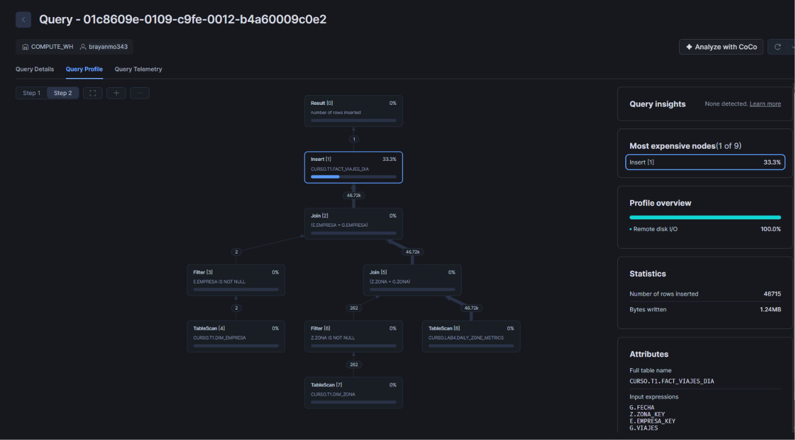

# Costos · Taller 1

Equipo: Brayan Andres Muñoz Bedoya, Diego Alejandro Miranda Marin y Julian Andres Urrea Escobar · Cuenta que reporta: Brayan Andres Muñoz Bedoya (cuenta propia de Snowflake; la estrella es idéntica a la del anfitrión)

## Créditos usados

Consulta corrida en la cuenta que reporta (medición desde el día de la clase):

```sql
USE SCHEMA CURSO.T1;
SELECT ROUND(SUM(CREDITS_USED), 4) AS CREDITOS
FROM TABLE(INFORMATION_SCHEMA.WAREHOUSE_METERING_HISTORY(
       DATE_RANGE_START => '2026-11-10'::DATE,
       WAREHOUSE_NAME => 'COMPUTE_WH'));
```

| Día medido | Warehouse | Tamaño | Créditos |
|---|---|---|---|
| Desde 2026-11-10 (corrida del 2026-11-13) | COMPUTE_WH | XS | 0.0980 |

Referencia de presupuesto (estimación del pensum, no medida): hasta 0.3 créditos el Lab 4 y hasta 0.8 el taller en clase. Quedamos muy por debajo: 0.0980 en total.

## Consulta más pesada

- Consulta: la carga del hecho, `INSERT OVERWRITE INTO FACT_VIAJES_DIA` de `02_carga.sql`. Duró 1,9 s.
- Cómo la encontramos: Snowsight > Monitoring > Query History > ordenar por duración. Después de ella quedaron el `COPY INTO` del Lab 4 (1,7 s) y las cargas de las dimensiones (1,3 s o menos). Las cinco preguntas C1 a C5 duraron menos de 0,6 s cada una (la más lenta, C1, 508 ms).
- Captura del Query Profile: `query_profile.png` (en esta carpeta).



## Lectura del Query Profile

- Operador que concentra el tiempo: `Insert [1]` sobre `CURSO.T1.FACT_VIAJES_DIA`, con el 33,3 % del tiempo, y es el primero de "Most expensive nodes". Los joins y los escaneos de tablas (`DAILY_ZONE_METRICS`, `DIM_ZONA`, `DIM_EMPRESA`) quedaron en 0 %. El perfil general marca 100 % de *Remote disk I/O*: el costo es escribir las 46 715 filas (1,24 MB), no calcular. Snowsight no detectó problemas ("Query insights: None detected").
- Qué haríamos para reducirlo: el costo está en la escritura, y `INSERT OVERWRITE` reescribe toda la tabla en cada corrida. Con un volumen mucho mayor cargaríamos de forma incremental (solo las fechas nuevas) en lugar de sobrescribir todo, y evitaríamos volver a correr la carga completa sin necesidad.

## Warehouse

COMPUTE_WH, tamaño XS, suspensión automática a los 60 s y reanudación automática (lo fija el Paso 0 de los labs). Se suspende solo a los 60 s de inactividad, así que no hizo falta suspenderlo a mano al terminar.
