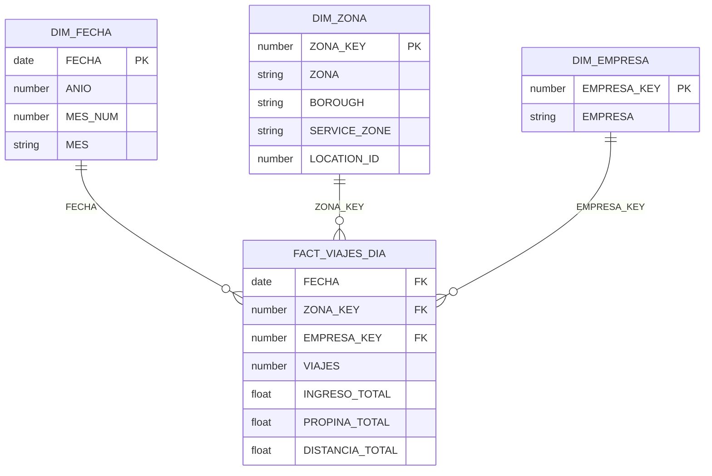

# Diagrama de la estrella · Taller 1 · Caso C

Equipo: <nombres>

Grano (el mismo de la primera línea de `01_estrella.sql`): **una fila por fecha, zona de recogida y empresa.**

## Claves

| Dimensión | Clave | Por qué es única |
|---|---|---|
| DIM_FECHA | `FECHA` | Una fila por fecha distinta del gold: 91 días (2024-01-01 a 2024-03-31). |
| DIM_ZONA | `ZONA_KEY` | Se agrupa por nombre de zona antes de numerar: 262 zonas, una por nombre. Así unir el gold por nombre no duplica filas. |
| DIM_EMPRESA | `EMPRESA_KEY` | Se numera sobre `SELECT DISTINCT EMPRESA`: Lyft = 1, Uber = 2. |

## Tamaños

| Tabla | Filas |
|---|---|
| FACT_VIAJES_DIA | 46 715 (60 268 466 viajes) |
| DIM_FECHA | 91 |
| DIM_ZONA | 262 |
| DIM_EMPRESA | 2 |
